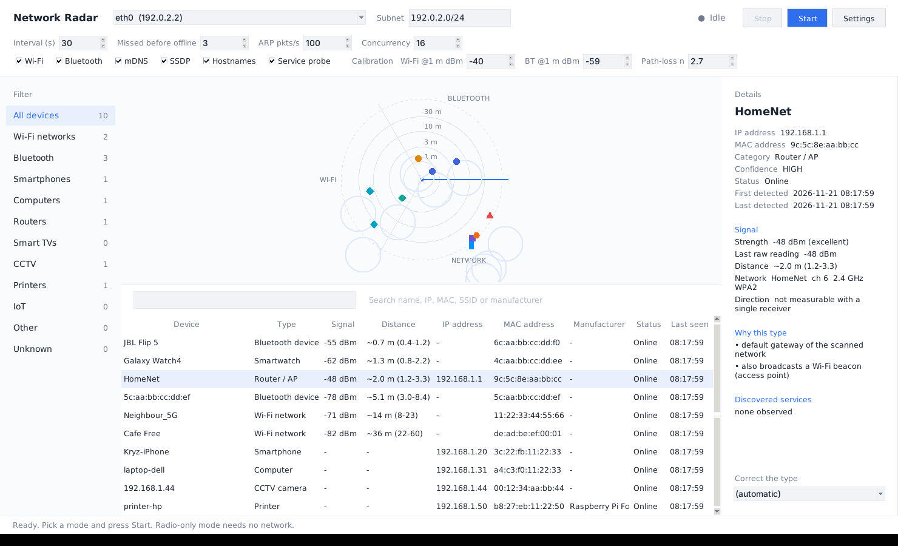

# NETWORK RADAR

Desktop (Tkinter) application that discovers and monitors devices on a local IPv4 network **you own or are authorised to monitor**, and shows them on an animated radar. Python 3, Scapy (ARP), stdlib mDNS/SSDP, psutil. **No database and no persistent storage** - all device state lives in RAM and disappears when the window closes.


*Preview rendered with simulated devices (no real scan).*

## Modes

| Mode | Needs | Sees |
|---|---|---|
| **Radio only** (default when no network) | A Wi-Fi adapter switched on and/or a Bluetooth adapter. **No network, no Wi-Fi connection, no internet.** | Every Wi-Fi access point whose beacon you can hear (including other people's networks, with SSID, channel, security and signal) and nearby Bluetooth/BLE devices, each with signal strength |
| **Network** | An interface with an IPv4 address (Wi-Fi *or* wired Ethernet) | Devices on your own subnet through ARP, mDNS, SSDP, hostnames and a fixed list of service ports |

Both can run together: pick an interface, and Wi-Fi/Bluetooth listening is added automatically.

## What it can and cannot see (read this first)

- **Radio-only is passive.** It only *listens* to Wi-Fi beacons and Bluetooth advertising. It never joins, probes or attacks anything, so it needs no authorisation prompt and can see networks outside your own.
- **Network mode only reaches your own subnet.** ARP only works on the same Layer-2 segment, and active probing is deliberately limited to a private subnet *inside the selected interface's network* (`utils/validators.py`). Scanning other people's networks or public ranges is refused on purpose: that would be unauthorised scanning, and nothing in this tool can or should do it.
- **No tool sees "everything".** Devices that are powered off, not advertising, on another VLAN, behind AP isolation, or using Wi-Fi power-save may be missed. Phones and watches randomise Bluetooth and MAC addresses, so identities can change.
- **Classification is an estimate.** Every result shows a confidence and the reasons. You can override any type manually (marked `*`).

## How positioning works (and its honest limits)

- **Distance is estimated from signal strength (RSSI)** with the log-distance path-loss model `d = 10^((ref - RSSI) / (10 n))`. RSSI is smoothed per device with a Kalman filter (Bluetooth: median of the scan window first) so the blip does not jitter.
- **It is always shown as a range**, e.g. `~5 m (3.0-8.4)`, because walls, bodies and reflections change RSSI by several dB. Real-world accuracy of RSSI ranging is roughly +/-50 %. No software can make it exact.
- **To improve accuracy, calibrate:** open *Settings*, hold a device 1 m from your adapter, and set *Wi-Fi @1 m* / *BT @1 m* to the dBm you see; raise *Path-loss n* (2.5-4) in cluttered indoor spaces.
- **Direction cannot be measured** with one antenna. The angle on the radar only places a device in the sector of the technology that found it (NETWORK / WI-FI / BLUETOOTH). Devices with no signal reading (ARP-only LAN hosts) sit in the dashed outer band, labelled "distance unknown", instead of at a fake position.
- Getting true bearing needs hardware this tool does not have (antenna array / direction-finding Bluetooth 5.1 AoA, or several receivers triangulating).

## Search mode (track one device) and honest limits

- Select any discovered device and tick **Track this device**. The registry then watches that
  one device for three things: its smoothed distance crossing below 5 m ("very close"), it going
  offline, and it coming back online - each raises a one-time alert (status bar + popup for "lost").
- The details panel also shows a **trend**: "getting closer" / "moving away" / "holding steady",
  computed from the same Kalman-smoothed RSSI the radar already uses, via a deadbanded slope
  estimator so normal signal jitter does not flip the label every reading (`utils/signal.py:DistanceTrend`).
- **What this is not**: it is not a position, not a direction/bearing, and not GPS. One antenna
  cannot tell you which way a signal is coming from - only whether the estimated distance is
  trending up or down. Use it as a "getting warmer/colder" aid while you physically move around,
  the way you would with a single-antenna fox-hunting receiver.

## Safety design

- Network scanning needs an explicit confirmation dialog for every start.
- The scope must be a **private** subnet *inside the selected interface's own network*, and at most 1024 hosts. Public ranges and foreign subnets are rejected.
- Observations whose IP is outside the scope are discarded; SSDP description fetches only go to the host that answered, over plain HTTP, size-capped, with XML entity declarations rejected.
- ARP rate and batching are configurable; TCP service probes use a global rate limiter and a fixed list of 19 ports (connect only, no banner grabbing, logins or exploitation).
- No credential attempts, no camera access, no stealth, no destructive operations.

## Install on Kali Linux

```bash
sudo apt update
sudo apt install -y python3 python3-venv python3-tk ieee-data libpcap0.8 iw bluez network-manager
# iw = Wi-Fi radio survey, bluez = Bluetooth, network-manager (nmcli) = refreshes the Wi-Fi scan

cd NETWORK-RADAR
python3 -m venv --copies venv        # --copies matters: see "Privileges" below
source venv/bin/activate
pip install -r requirements.txt
```

`ieee-data` provides the OUI vendor database (`/usr/share/ieee-data/oui.txt`). Without it only a tiny built-in list is used and most vendors show as `-`.

### Privileges (do not run the whole GUI as root)

ARP (network mode) needs raw sockets. **Radio-only mode needs no special privileges.** Preferred: grant only `CAP_NET_RAW` to the **venv's private copy** of Python (this is why the venv is created with `--copies`; never `setcap` the system interpreter):

```bash
sudo setcap cap_net_raw,cap_net_admin=eip venv/bin/python3
getcap venv/bin/python3
```

Anything run with that interpreter can open raw sockets, so keep this venv dedicated to NETWORK RADAR. Remove with `sudo setcap -r venv/bin/python3`. Re-run `setcap` after recreating the venv. Fallback (less preferred): `sudo -E venv/bin/python3 main.py` (needs `DISPLAY`/`XAUTHORITY` preserved, e.g. `xhost +SI:localuser:root`).

> I could not verify the capability route on a real Kali machine from the build sandbox. If ARP still fails with "operation not permitted", use the sudo fallback and report the error text.

### Run / stop

```bash
source venv/bin/activate
python3 main.py                  # optional: --log-level DEBUG
```

Pick the interface, keep or narrow the subnet, press **START SCANNING**, confirm authorisation. **STOP SCANNING** cancels between ARP batches (a few seconds at most). Closing the window stops everything and clears memory.

### Troubleshooting

| Symptom | Fix |
|---|---|
| `tkinter is missing` | `sudo apt install python3-tk` |
| `ModuleNotFoundError: scapy/psutil` | activate the venv, `pip install -r requirements.txt` |
| Status bar: "No raw-socket privilege" | do the `setcap` step above (check `getcap venv/bin/python3`) |
| "Interface ... unavailable" | interface is down or renamed (`ip -br a`) |
| Many `-` manufacturers | `sudo apt install ieee-data` |
| Subnet rejected | must be private and inside the interface network (e.g. `192.168.1.0/24` or smaller) |
| Radio only: "iw not found" / "No Wi-Fi adapter" | `sudo apt install iw`; check `iw dev` and `rfkill list` (Wi-Fi must not be blocked) |
| Wi-Fi list is stale | `sudo apt install network-manager` so a rescan can be triggered |
| Nothing from mDNS/SSDP | firewall blocking multicast replies, or devices do not advertise |
| Bluetooth: "bluetoothctl not found" | `sudo apt install bluez`; needs an adapter (`bluetoothctl list`, `bluetoothctl power on`) |
| Cannot open display | run from a desktop session; check `echo $DISPLAY` |

## Tests

```bash
./run_tests.sh          # or: python3 -m unittest discover -s tests -t . -v
```

Uses only the standard library (also runs under pytest if you have it). Network is mocked: a fake Scapy API, scripted discovery modules, hand-built mDNS/SSDP packets, a fake psutil, a stub toolkit for GUI logic.

### Safe integration test (real network)

1. Use a network you own (e.g. your home LAN), with at least one device you can identify (your phone, a printer).
2. Start the app, leave the default subnet, start scanning. Within one cycle (~10-60 s, longer on /22) you should see: your own machine ("this machine"), the gateway classified Router, and the known devices.
3. Compare against `ip neigh` and `sudo arp-scan --localnet` (if installed) - the IP/MAC sets should agree for hosts that were awake.
4. Turn the known device's Wi-Fi off. After *Missed before offline* cycles (default 3 x interval) it turns grey/dashed and **Offline**; turn Wi-Fi on and it should be **reappeared**.
5. Try a foreign subnet (e.g. `10.99.0.0/24` when you are on `192.168.1.0/24`) and a public one (`8.8.8.0/24`): both must be refused.
6. Use STOP mid-scan and confirm it ends promptly; restart the app and confirm no devices persisted.

## Architecture

```
main.py                      entry point
config/    defaults.py settings.py        constants / runtime-adjustable Settings (validated, atomic update)
core/      application.py                 ApplicationController: wiring + dependency injection
           network_monitor.py             background scan loop, cycle lock, enrichment, event publishing
           event_manager.py               EventType, thread-safe bounded EventBus
discovery/ base_discovery.py              BaseDiscovery (abstract) + DiscoveryContext/Error
           arp_discovery.py mdns_discovery.py ssdp_discovery.py wifi_discovery.py bluetooth_discovery.py
devices/   device.py observation.py       Device dataclass, Observation (evidence record)
           device_registry.py             in-memory store (dict + indexes + sets)
           device_classifier.py           evidence scoring, confidence, reasons
           manufacturer_lookup.py         OUI lookup from local files
network/   interface_manager.py subnet_manager.py network_utils.py
ui/        dashboard.py radar.py radar_math.py sidebar.py device_table.py device_details.py
           theme.py components/top_bar.py
utils/     validators.py logger.py timestamps.py rate_limiter.py
tests/
```

Key decisions:

- **Threads never touch widgets.** Workers publish `Event`s to a bounded queue; the Tk thread polls every 100 ms and applies *incremental* updates (per-device row/blip updates; a full table refresh happens once per cycle, for "last seen").
- **Registry returns snapshots**, never live objects, so GUI and workers cannot race on a `Device`.
- **Identity**: MAC is the key. Observations that only have an IP (mDNS/SSDP) create `ip:<addr>` records that are *promoted* to the MAC key when ARP supplies it, or *merged* if the MAC already exists. Same IP with a different MAC = new device (DHCP reuse).
- **Offline logic**: a device's missed counter only increments in cycles where a protocol that has reported it *ran successfully* and nobody reported it. A failed or disabled protocol never causes offline marking. Reverse-DNS and port probes do not count as "seen". The scanning host itself never goes offline.
- **Inheritance** is used once, for the `BaseDiscovery` interface (polymorphic discovery modules). Everything else is composition.
- **Tkinter** (not CustomTkinter) with a custom `ttk` dark style: one less dependency.
- mDNS is implemented with the standard library (legacy-unicast queries) so no avahi/zeroconf is needed.

### Complexity (n devices, k results, o online, C = 10 categories)

| Operation | Time | Space |
|---|---|---|
| `apply(observation)` | O(1) expected (dict lookups) + O(rules) classification | O(1) per new device |
| `get`, `set_manual_category` | O(1) | O(1) |
| `begin_cycle` | O(1) | - |
| `end_cycle` | O(o) | O(gone) |
| `counts()` | O(C) set intersections | O(C) |
| `query(categories)` | O(k) + O(k) snapshots | O(k) |
| `query(text)` | O(n) scan | O(k) |
| table sort | O(n log n), only when rows are inserted or a header is clicked | O(n) |
| radar frame | O(online blips) cheap math; canvas `itemconfigure` only when a blip's brightness level (8 levels) changes | O(n) canvas items |
| ARP scan | O(hosts / batch) srp calls; time ~ hosts/rate + batches x timeout | O(hosts) |

Total memory: O(n) for devices plus three O(n) indexes (MAC, IP, category).

## Verification status (honest report)

Executed in the build sandbox (Ubuntu 24.04, Python 3.12): **113 unit tests pass**, including path-loss maths, Kalman smoothing, `iw`/`bluetoothctl` parsing (hostile input too), signal handling in the registry, radio-only monitor mode (no network), and radar geometry. The real Tk GUI was rendered on a virtual display with simulated devices (see preview) and the radio-only Start/Stop path was exercised for real.

**Not verified - please test on your machine:**

- Real Wi-Fi and Bluetooth hardware: the sandbox has no radios, so `iw dev ... scan dump` and `bluetoothctl` parsing were tested against sample output in the documented formats, not live adapters. Output formats can vary slightly between `iw`/BlueZ versions.
- The accuracy of distance estimates in your rooms (calibrate as described above).
- Real Scapy ARP scanning and the `setcap` privilege route (unchanged from the original).
- Behaviour with hundreds of real devices.
- **Search mode / track one device**: the trend math (`DistanceTrend`) and the alert logic
  (very-close / lost / reappeared) are unit-tested end to end against the registry, but the
  *feel* of chasing a real signal around a real room has not been field-tested - expect to tune
  `TARGET_CLOSE_THRESHOLD_M` and the Settings calibration for your space.


RUN:
source ~/venv/bin/activate
cd ~/NETWORK-RADAR
python3 main.py